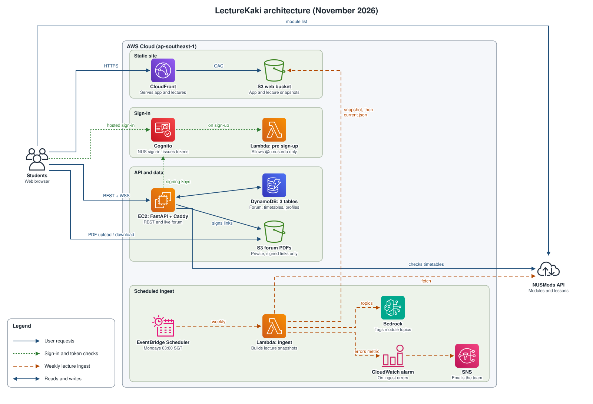

# Architecture

React/TypeScript runs in the browser; FastAPI runs as one backend image on EC2 behind Caddy HTTPS. Lecture ingestion and Cognito signup validation are separate Lambdas. CloudFront serves the app and lecture JSON from a private S3 origin using OAC. Terraform provisions hosting, API and ingestion; existing CloudFormation stacks retain Cognito and application data. See [deployment](deployment.md) for resource ownership and releases.



The figure is generated by [`diagrams/architecture.py`](diagrams/architecture.py); edit and rerun it when the architecture changes.

## Repository structure

```text
.
├── frontend/
│   └── src/features/        # Discovery, timetable and Forum UI
├── backend/
│   ├── app/
│   │   ├── main.py         # CORS, error handling and router registration
│   │   └── modules/        # Auth, Forum and timetable schemas, rules and data access
│   ├── jobs/lecture_ingest/ # NUSMods fetching, calendar expansion and publication
│   ├── lambdas/pre_signup/ # NUS email signup validation
│   ├── scripts/            # Local ingestion and Lambda packaging
│   └── tests/              # Backend and ingestion tests
├── infra/                  # Existing CloudFormation templates
│   └── terraform/          # Hosting, API, ingestion and deployment-role configuration
├── scripts/smoke_test.py    # API smoke checks
├── docs/                   # Development, architecture and deployment guides
├── .github/workflows/      # CI checks and Terraform deployment
└── compose.yaml            # Local services and test containers
```

Add API features under `app/modules/<feature>/` and register routers in `main.py`. Modules own their data access and expose public interfaces. Jobs/triggers are excluded from the API runtime image.

## Identity and security

IAM credentials authorise AWS operations; Cognito accounts authenticate app users. Signup requires an `@u.nus.edu` address and email confirmation.

The [browser flow](../frontend/src/features/forum/auth.ts) uses authorization code flow, S256 PKCE and OAuth `state`. Tokens stay in `sessionStorage`; a non-secret cookie remembers prior login and a `localStorage` revision coordinates logout.

Protect routes with `Depends(get_current_user)` from `app.modules.auth`. The [validator](../backend/app/modules/auth/dependencies.py) checks RS256 signature, expiry, issuer, `client_id`, `token_use=access` and non-empty `sub`. Use that verified `sub` as the user/author ID and enforce ownership separately. ID tokens are not API credentials. Invalid/missing tokens return `401`; unavailable auth configuration/signing keys return `503`.

The [auth template](../infra/auth.yaml) sets access tokens to 15 minutes and refresh tokens to 30 days. Logout clears local tokens, attempts refresh-token revocation and ends the hosted session; issued access tokens can still pass JWT validation until expiry.

## Lecture snapshots and room identity

Read `/lectures/current.json`, then use its `path` for `index.json`, `modules.json` (module details, including up to three topics: [title keywords](../backend/jobs/lecture_ingest/topics.py) first, then an [LLM on Bedrock](../backend/jobs/lecture_ingest/llm_topics.py) adds topics from descriptions, cached in `lectures/topic-cache.json`) and `weeks/<label>.json` or `days/<date>.json`. The [publisher](../backend/jobs/lecture_ingest/publish.py) completes the snapshot before switching the pointer. Snapshots use `public, max-age=86400, immutable`; the pointer uses `no-cache`. Empty data and same-semester session counts below half the previous run are rejected.

Fields are defined by the [transformer](../backend/jobs/lecture_ingest/transform.py) and [frontend types](../frontend/src/features/discovery/types.ts). Coordinate format changes across producer, consumers and tests. Unknown capacity uses `size=0`; online or unmapped venues use `building=null`.

Only `Lecture` lessons are published, excluding NUS-ISS courses. Session dates and lesson times use Singapore time; `generatedAt` is a UTC ISO timestamp. The [calendar](../backend/jobs/lecture_ingest/academic_calendar.py) covers AY2026/27 Semesters 1–2, holidays and early closures; extend it for later years.

Session IDs are `<moduleCode>-<lessonTypeCode>-<classNo>@<date>-<HHMM>-<venue>`. Preserve class-number leading zeroes and venue slashes. A changed date, start time or venue creates a different occurrence. Forum rooms append `@<acadYear>@<semester>`; URL-encode the whole room ID. The [browser](../frontend/src/features/forum/roomCatalogue.ts) checks an exact current-catalogue match; the backend validates format, date, time and academic year.

## Search

Search runs in the browser; neither search calls the API.

- **Discover:** the query is split into words. A lecture matches when every word appears, in any order, in its module's code, title, description or topics ([`filterSessions`](../frontend/src/features/discovery/discoveryFilters.ts)). Venues and cross-listed codes are not searched; use the Buildings and Subject codes filters. Results stay grouped by day. Within each day, [`rankWithinDays`](../frontend/src/features/discovery/discoveryFilters.ts) orders matches best first, then by start time:
  1. The code starts with the query (spaces ignored).
  2. The title starts with the query.
  3. Every word starts a word in the title, or starts the code.
  4. Every word appears in the code or title.
  5. Every word appears in the code, title or topics.
  6. Only the description matches.
- **Add a module (Timetable):** [`searchModules`](../frontend/src/features/timetable/moduleSearch.ts) filters NUSMods' `moduleList.json` for the selected academic year to modules offered in the selected semester whose code or title contains every word. It ranks an exact code first, then the same tiers as Discover without topics or descriptions, then by code. The page shows 20 results at a time.

## Persistence and live updates

- **Timetables:** the [UI](../frontend/src/features/timetable/TimetablePage.tsx) loads/saves a four-semester book through `/timetable/semesters` and keeps local selections. The [API](../backend/app/modules/timetable/api.py) validates selections against NUSMods. The [repository](../backend/app/modules/timetable/repository.py) stores one record per Cognito `sub`, with last-write-wins replacement. Legacy `/timetable` routes remain supported.
- **Interest topics:** an ordered list. On [Profile](../frontend/src/features/profile/ProfilePage.tsx), new picks go to the end and can be reordered or removed. Signed in, the list is saved through `PUT /profile/topics`, and the API keeps the order (it only drops duplicates). Signed out, it is saved in the browser's `localStorage` (`lecturekaki:topics:v1`). On sign-in, browser topics are copied to an account that has none; otherwise the account's list wins, and the browser copy is kept for when the user signs out. The [sidebar](../frontend/src/features/profile/SidebarTopics.tsx) shows the first five, or three suggestions if none are picked. Discover's "Only my topics" uses the whole list. Both follow saves immediately through `subscribeToTopicUpdates` in [profileApi](../frontend/src/features/profile/profileApi.ts).
- **Forum:** authenticated HTTP reads/creates messages and allows author-only deletion. Messages allow 1–500 characters and are hidden after 24 hours. Records use `ROOM#<room_id>` / `MSG#<message_id>`; DynamoDB TTL on `ttl` performs eventual cleanup. See [schemas](../backend/app/modules/forum/schemas.py) and [service](../backend/app/modules/forum/service.py).
- **WebSockets:** request `POST /rooms/{room_id}/connection-ticket` with the Bearer access token, then connect to the returned `path` on the API's `ws://` or `wss://` origin. The path is `/rooms/{room_id}/live?ticket=...`. Posting/deletion remain authenticated HTTP operations; writes persist before broadcast. See [routes](../backend/app/modules/forum/api.py) and [client](../frontend/src/features/forum/forumSocket.ts).
- Tickets are room-bound, single-use and valid for at most 30 seconds; hashed records use `TICKET#<hash>` / `METADATA`. Sockets expire with the access token; the client refreshes credentials/history on reconnect. The [room hub](../backend/app/modules/forum/realtime.py) requires **one API instance and one worker**. Separate APIs share history but not live events.
