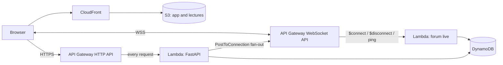

# Architecture

React/TypeScript runs in the browser. FastAPI runs on Lambda behind an API Gateway HTTP API, and Forum live updates use an API Gateway WebSocket API, so the API keeps no per-process state and scales horizontally (see [scaling](#scaling-the-api-and-live-updates)). Lecture ingestion and Cognito signup validation are separate Lambdas. CloudFront serves the app and lecture JSON from a private S3 origin using OAC. Terraform provisions hosting, API and ingestion; existing CloudFormation stacks retain Cognito and application data. See [deployment](deployment.md) for resource ownership and releases.


The figure is generated by [`diagrams/architecture.py`](diagrams/architecture.py); edit and rerun it when the architecture changes.

## Repository structure

```text
.
├── frontend/
│   └── src/features/        # Discovery, timetable and Forum UI
├── backend/
│   ├── app/
│   │   ├── main.py         # CORS, error handling and router registration
│   │   └── modules/        # Auth, Forum and timetable schemas, rules and data access
│   ├── jobs/lecture_ingest/ # NUSMods fetching, calendar expansion and publication
│   ├── lambdas/pre_signup/ # NUS email signup validation
│   ├── scripts/            # Local ingestion and Lambda packaging
│   └── tests/              # Backend and ingestion tests
├── infra/                  # Existing CloudFormation templates
│   └── terraform/          # Hosting, API, ingestion and deployment-role configuration
├── scripts/smoke_test.py    # API smoke checks
├── docs/                   # Development, architecture and deployment guides
├── .github/workflows/      # CI checks and Terraform deployment
└── compose.yaml            # Local services and test containers
```

Add API features under `app/modules/<feature>/` and register routers in `main.py`. Modules own their data access and expose public interfaces. Jobs/triggers are excluded from the API runtime image.

## Identity and security

IAM credentials authorise AWS operations; Cognito accounts authenticate app users. Signup requires an `@u.nus.edu` address and email confirmation.

The [browser flow](../frontend/src/features/forum/auth.ts) uses authorization code flow, S256 PKCE and OAuth `state`. Tokens stay in `sessionStorage`; a non-secret cookie remembers prior login and a `localStorage` revision coordinates logout.

Protect routes with `Depends(get_current_user)` from `app.modules.auth`. The [validator](../backend/app/modules/auth/dependencies.py) checks RS256 signature, expiry, issuer, `client_id`, `token_use=access` and non-empty `sub`. Use that verified `sub` as the user/author ID and enforce ownership separately. ID tokens are not API credentials. Invalid/missing tokens return `401`; unavailable auth configuration/signing keys return `503`.

The [auth template](../infra/auth.yaml) sets access tokens to 15 minutes and refresh tokens to 30 days. Logout clears local tokens, attempts refresh-token revocation and ends the hosted session; issued access tokens can still pass JWT validation until expiry.

## Lecture snapshots and room identity

Read `/lectures/current.json`, then use its `path` for `index.json`, `modules.json` (module details, including up to three topics: [title keywords](../backend/jobs/lecture_ingest/topics.py) first, then an [LLM on Bedrock](../backend/jobs/lecture_ingest/llm_topics.py) adds topics from descriptions, cached in `lectures/topic-cache.json`) and `weeks/<label>.json` or `days/<date>.json`. The [publisher](../backend/jobs/lecture_ingest/publish.py) completes the snapshot before switching the pointer. Snapshots use `public, max-age=86400, immutable`; the pointer uses `no-cache`. Empty data and same-semester session counts below half the previous run are rejected.

Fields are defined by the [transformer](../backend/jobs/lecture_ingest/transform.py) and [frontend types](../frontend/src/features/discovery/types.ts). Coordinate format changes across producer, consumers and tests. Unknown capacity uses `size=0`; online or unmapped venues use `building=null`.

Only `Lecture` lessons are published, excluding NUS-ISS courses. Session dates and lesson times use Singapore time; `generatedAt` is a UTC ISO timestamp. The [calendar](../backend/jobs/lecture_ingest/academic_calendar.py) covers AY2026/27 Semesters 1–2, holidays and early closures; extend it for later years.

Session IDs are `<moduleCode>-<lessonTypeCode>-<classNo>@<date>-<HHMM>-<venue>`. Preserve class-number leading zeroes and venue slashes. A changed date, start time or venue creates a different occurrence. Forum rooms append `@<acadYear>@<semester>`; URL-encode the whole room ID. The [browser](../frontend/src/features/forum/roomCatalogue.ts) checks an exact current-catalogue match; the backend validates format, date, time and academic year.

## Search

Search runs in the browser; neither search calls the API.

- **Discover:** the query is split into words. A lecture matches when every word appears, in any order, in its module's code, title, description or topics ([`filterSessions`](../frontend/src/features/discovery/discoveryFilters.ts)). Venues and cross-listed codes are not searched; use the Buildings and Subject codes filters. Results stay grouped by day. Within each day, [`rankWithinDays`](../frontend/src/features/discovery/discoveryFilters.ts) orders matches best first, then by start time:
  1. The code starts with the query (spaces ignored).
  2. The title starts with the query.
  3. Every word starts a word in the title, or starts the code.
  4. Every word appears in the code or title.
  5. Every word appears in the code, title or topics.
  6. Only the description matches.
- **Add a module (Timetable):** [`searchModules`](../frontend/src/features/timetable/moduleSearch.ts) filters NUSMods' `moduleList.json` for the selected academic year to modules offered in the selected semester whose code or title contains every word. It ranks an exact code first, then the same tiers as Discover without topics or descriptions, then by code. The page shows 20 results at a time.

## Persistence and live updates

- **Timetables:** the [UI](../frontend/src/features/timetable/TimetablePage.tsx) loads/saves a four-semester book through `/timetable/semesters` and keeps local selections. The [API](../backend/app/modules/timetable/api.py) validates selections against NUSMods. The [repository](../backend/app/modules/timetable/repository.py) stores one record per Cognito `sub`, with last-write-wins replacement. Legacy `/timetable` routes remain supported.
- **Interest topics:** an ordered list. On [Profile](../frontend/src/features/profile/ProfilePage.tsx), new picks go to the end and can be reordered or removed. Signed in, the list is saved through `PUT /profile/topics`, and the API keeps the order (it only drops duplicates). Signed out, it is saved in the browser's `localStorage` (`lecturekaki:topics:v1`). On sign-in, browser topics are copied to an account that has none; otherwise the account's list wins, and the browser copy is kept for when the user signs out. The [sidebar](../frontend/src/features/profile/SidebarTopics.tsx) shows the first five, or three suggestions if none are picked. Discover's "Only my topics" uses the whole list. Both follow saves immediately through `subscribeToTopicUpdates` in [profileApi](../frontend/src/features/profile/profileApi.ts).
- **Forum:** authenticated HTTP reads/creates messages and allows author-only deletion. Messages allow 1–500 characters and are hidden after 24 hours. Records use `ROOM#<room_id>` / `MSG#<message_id>`; DynamoDB TTL on `ttl` performs eventual cleanup. See [schemas](../backend/app/modules/forum/schemas.py) and [service](../backend/app/modules/forum/service.py).
- **WebSockets:** request `POST /rooms/{room_id}/connection-ticket` with the Bearer access token, then open the returned `path`. Deployed, it is the API Gateway WebSocket URL, `wss://<id>.execute-api.<region>.amazonaws.com/live?room=...&ticket=...`; locally (no `FORUM_WEBSOCKET_URL`) it is `/rooms/{room_id}/live?ticket=...` on the API's own origin. Posting/deletion remain authenticated HTTP operations; writes persist before broadcast. See [routes](../backend/app/modules/forum/api.py), [gateway delivery](../backend/app/modules/forum/gateway.py) and [client](../frontend/src/features/forum/forumSocket.ts).
- Tickets are room-bound, single-use and valid for at most 30 seconds; hashed records use `TICKET#<hash>` / `METADATA`. Connections are recorded as `ROOM#<room_id>` / `CONN#<connectionId>` plus `CONN#<connectionId>` / `METADATA`, both with `ttl`. Connections stop receiving events when the access token expires; the client rotates the socket before then and refreshes credentials/history on reconnect. The in-memory [room hub](../backend/app/modules/forum/realtime.py) is only for local development, where it requires one process.

## Scaling the API and live updates

> **Status:** implemented in code and Terraform; it takes effect on the next reviewed `terraform apply`. The EC2 instance, Caddy and Elastic IP are destroyed by that apply; the Caddy certificate volume is kept but no longer managed (delete it by hand after cutover).

### Terms that are easy to confuse

- **WebSocket (protocol) vs API Gateway WebSocket API (AWS service).** WebSocket is the browser protocol: one long-lived two-way `wss://` connection. The Forum always used the protocol, but before this change the connection ended at our own FastAPI process on EC2, which held it. The API Gateway WebSocket API is an AWS service that holds the connections on our behalf. "We open a WebSocket" does not mean "we use the WebSocket API".
- **API Gateway is one service with three API types.** People usually mean the REST or HTTP type when they say "API Gateway"; the WebSocket type is separate. We create two APIs in it, with separate URLs, configuration and pricing:

  | API type      | What it does                                                                        | Used for                                  |
  | ------------- | ----------------------------------------------------------------------------------- | ----------------------------------------- |
  | REST API      | Request → response with extras (API keys, usage plans, caching)                     | Not used                                  |
  | HTTP API      | Lighter, cheaper request → response                                                 | Every normal request → the FastAPI Lambda |
  | WebSocket API | Holds long-lived connections; invokes routes on `$connect`, `$disconnect`, messages | Forum live updates (`wss://…/live`)       |

  "API gateway" is also a general pattern (one front door that routes, authenticates and rate-limits); Caddy played a small version of that role on EC2.

- **Who triggers Lambda.** A Lambda never runs on its own; an event invokes it, it handles that event and stops. The HTTP API invokes the FastAPI function per request; the WebSocket API invokes the live function on connect, disconnect and each client message. Between events no Lambda runs: API Gateway keeps the socket open. (EventBridge Scheduler triggering ingestion and Cognito triggering pre-signup are the same pattern.)
- **Stateless vs stateful.** A process is stateless when any copy can serve any request because nothing it _needs_ lives only in its memory. Messages, tickets, uploads and now connection records are in DynamoDB/S3; the user is identified by the JWT on each request. The `lru_cache`s (Cognito signing keys, NUSMods data) are only speed-ups that any copy can rebuild, so they are fine.
- **Push vs polling.** Polling means each browser requests `GET /messages` on a timer, so load grows with users × time even when nothing happens. The Forum does **not** poll: events are pushed only when a message is created or deleted. The client's `setInterval` is a keep-alive ping over the socket, and the [page](../frontend/src/features/forum/ForumPage.tsx) uses a local timer only to hide expired messages.
- **Caddy (removed).** A web server that ran beside FastAPI on EC2 as a reverse proxy. It obtained a short-lived Let's Encrypt certificate for the Elastic IP (there is no domain, so ACM could not be used), terminated HTTPS/WSS and forwarded to uvicorn. API Gateway now provides HTTPS.

### Why the old design could run on only one instance

Live delivery kept two things in one Python process's memory ([`RoomHub`](../backend/app/modules/forum/realtime.py)): **the open sockets** and **the room membership map** `rooms: dict[room_id, dict[WebSocket, expiry]]`. `hub.publish()` looped over that map, so with two instances (or two uvicorn workers, which also have separate memory) a user connected to one missed messages posted through the other:

```text
Alice ──wss──► API A   rooms = {CS2040: [Alice]}
Bob   ──wss──► API B   rooms = {CS2040: [Bob]}
Bob posts → API B saves to DynamoDB, then loops over B's map → only Bob is notified
            API A is never told → Alice sees it only after reloading history
```

The infrastructure was also single-instance: Caddy's IP-bound certificate on one EBS volume in one Availability Zone, one Elastic IP with no load balancer, an image built on the instance at boot, and instance replacement (downtime) on every API release.

### What changed

Both pieces of state moved out of the process. The publish loop still exists; what changed is where it runs and what it loops over:

|                      | Before                                        | Now                                                                                                                         |
| -------------------- | --------------------------------------------- | --------------------------------------------------------------------------------------------------------------------------- |
| Open sockets held by | Our FastAPI process on EC2                    | API Gateway's managed connection fleet; each connection has a `connectionId`                                                |
| Room membership map  | Python `dict` in RAM                          | DynamoDB items in the Forum table (`ROOM#…` / `CONN#…`, with `ttl`)                                                         |
| Publish loop runs in | The one process that has the sockets          | Any FastAPI Lambda: query the room's connections, `PostToConnection` to each in parallel, drop `GoneException` ones         |
| Connect/disconnect   | `/rooms/{id}/live` route and `hub.join/leave` | `$connect` (checks Origin and the single-use ticket) and `$disconnect` invoke the live Lambda, which writes/deletes records |
| API compute          | One t3 EC2 instance, one uvicorn worker       | Lambda behind the HTTP API, scaling per request                                                                             |
| HTTPS                | Caddy + Let's Encrypt IP certificate          | API Gateway's `execute-api` endpoints                                                                                       |

### How it is built



- **Entry points:** [`app/aws_lambda.py`](../backend/app/aws_lambda.py). `http_handler` wraps the unchanged FastAPI app with [Mangum](https://pypi.org/project/mangum/), which converts HTTP API events to ASGI. `websocket_handler` routes WebSocket events to [`forum/gateway.py`](../backend/app/modules/forum/gateway.py).
- **Delivery:** [`gateway.py`](../backend/app/modules/forum/gateway.py) handles `$connect` (Origin check, `consume_ticket`, record the connection), `$disconnect` (delete the records), `$default` (answer pings; close on anything else) and `publish` (fan-out with up to 16 parallel sends; expired sessions are closed and removed; failures never fail a saved message). Connection records live in [`forum/repository.py`](../backend/app/modules/forum/repository.py).
- **Mode switch:** `FORUM_WEBSOCKET_URL` set (Terraform sets it) → tickets point at the WebSocket API and the routes publish through API Gateway. Unset (local Docker/uvicorn) → tickets point at `/rooms/{id}/live` and the in-memory hub is used. The frontend's [`forumSocketUrl`](../frontend/src/features/forum/forumApi.ts) opens absolute `wss://` URLs as given.
- **Package:** [`scripts/package_api.py`](../backend/scripts/package_api.py) builds `build/api.zip` from `app/` and the locked dependencies, downloading Linux x86-64 wheels whatever machine runs it. One package backs both functions; only the handler differs.
- **Infrastructure:** [`infra/terraform/api.tf`](../infra/terraform/api.tf) defines both Lambdas (separate least-privilege roles), the HTTP API (`$default` route and stage), the WebSocket API (`$connect`/`$disconnect`/`$default` routes, `live` stage), invoke permissions, `execute-api:ManageConnections` for fan-out and error alarms on the existing SNS topic. Outputs: `api_url` and `forum_websocket_url`.
- **Tests:** [`tests/forum/test_gateway.py`](../backend/tests/forum/test_gateway.py) covers ticket URLs, fan-out across connections, ticket/room/origin rejection, removal of gone and expired connections, disconnect, pings, unavailable storage and the Mangum handler. The local-mode tests in `test_live.py` still cover the in-process hub.

### Why API Gateway WebSocket API over the alternatives

- **AppSync Events** holds sockets _and_ membership and broadcasts with one publish call, so it needs less code and costs less per delivery; it suits pure room broadcast. We chose API Gateway because it exposes `connectionId` and `$connect`/`$disconnect` hooks, which likely features need: presence ("who is in this room"), messages to one user (companion requests, reply notifications), per-action logic over the socket (typing, polls) and force-closing a user's sockets on logout. It also keeps the client a plain WebSocket, close to the existing [`forumSocket.ts`](../frontend/src/features/forum/forumSocket.ts).
- **SSE (Server-Sent Events)** matches our one-way traffic, but it is only a transport: something must still hold connections, which brings back shared membership on servers, or bills every connected minute on Lambda response streaming.
- **Redis/Valkey pub/sub between servers** keeps FastAPI sockets and relays events between instances. It is the smallest code change but keeps always-on servers, a load balancer and a fixed ElastiCache cost, and it cannot run on Lambda.
- **Fargate instead of Lambda** for the HTTP API also works, because the API is now stateless. Lambda costs nothing while idle and needs no load balancer, VPC or certificate; Fargate would suit steady all-day traffic, strict no-cold-start needs or requests longer than 30 seconds. Only the compute behind the HTTP API would change.

### Cost and performance as users grow

Cost follows activity, not idle time. The drivers are HTTP requests, WebSocket connection-minutes and deliveries, where **deliveries = posts × viewers in the room**, so cost grows faster than users when rooms also grow. The WebSocket API bills per message and per connection-minute; each delivery also costs part of a Lambda invocation and the room's DynamoDB query. Idle cost is near zero, unlike the fixed EC2 instance. Check current [API Gateway](https://aws.amazon.com/api-gateway/pricing/) and [Lambda](https://aws.amazon.com/lambda/pricing/) pricing before quoting figures.

Fan-out time grows linearly with room size because each connection gets its own `PostToConnection`; sends run in parallel, and very large rooms would move fan-out to a DynamoDB Stream–triggered Lambda or a queue so posting returns before broadcast and failures are retried. Limits: 2-hour maximum connection duration and 10-minute idle timeout (the client pings every 4 minutes and rotates sockets before token expiry), 128 KB messages, the account quota on new connections per second, Lambda concurrency (default 1,000 per account) and the HTTP API's 30-second integration timeout. Each ping invokes the live Lambda; a mock integration could answer pings without Lambda if that cost matters. Cold starts add roughly a second to the first request after idle. A room's messages and connections share one DynamoDB partition, which is ample for class-sized rooms.
