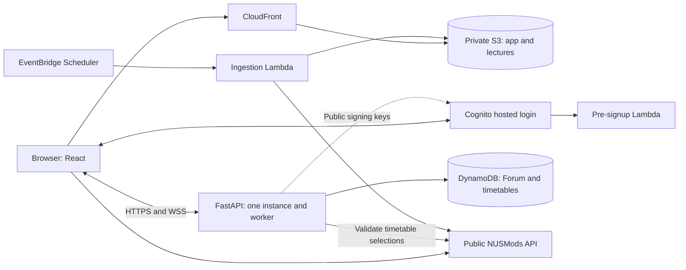

# Architecture

React/TypeScript runs in the browser; FastAPI runs as one backend image. Lecture ingestion and Cognito signup validation are separate Lambdas. The hosting template serves the app and lecture JSON through CloudFront with a private S3 origin and OAC. The API target is EC2 behind an HTTPS proxy such as Caddy; API hosting is not provisioned by this repository.



## Repository structure

```text
.
├── frontend/
│   └── src/features/        # Discovery, timetable and Forum UI
├── backend/
│   ├── app/
│   │   ├── main.py         # CORS, error handling and router registration
│   │   └── modules/        # Auth, Forum and timetable schemas, rules and data access
│   ├── jobs/lecture_ingest/ # NUSMods fetching, calendar expansion and publication
│   ├── lambdas/pre_signup/ # NUS email signup validation
│   ├── scripts/            # Local ingestion and Lambda packaging
│   └── tests/              # Backend and ingestion tests
├── infra/                  # Auth, hosting, ingestion and timetable CloudFormation
├── scripts/smoke_test.py    # API smoke checks
├── docs/                   # Development, architecture and deployment guides
├── .github/workflows/      # CI checks and container builds
└── compose.yaml            # Local services and test containers
```

Add API features under `app/modules/<feature>/` and register routers in `main.py`. Modules own their data access and expose public interfaces. Jobs/triggers are excluded from the API runtime image.

## Identity and security

IAM credentials authorise AWS operations; Cognito accounts authenticate app users. Signup requires an `@u.nus.edu` address and email confirmation.

The [browser flow](../frontend/src/features/forum/auth.ts) uses authorization code flow, S256 PKCE and OAuth `state`. Tokens stay in `sessionStorage`; a non-secret cookie remembers prior login and a `localStorage` revision coordinates logout.

Protect routes with `Depends(get_current_user)` from `app.modules.auth`. The [validator](../backend/app/modules/auth/dependencies.py) checks RS256 signature, expiry, issuer, `client_id`, `token_use=access` and non-empty `sub`. Use that verified `sub` as the user/author ID and enforce ownership separately. ID tokens are not API credentials. Invalid/missing tokens return `401`; unavailable auth configuration/signing keys return `503`.

The [auth template](../infra/auth.yaml) sets access tokens to 15 minutes and refresh tokens to 30 days. Logout clears local tokens, attempts refresh-token revocation and ends the hosted session; issued access tokens can still pass JWT validation until expiry.

## Lecture snapshots and room identity

Read `/lectures/current.json`, then use its `path` for `index.json`, `modules.json` and `weeks/<label>.json` or `days/<date>.json`. The [publisher](../backend/jobs/lecture_ingest/publish.py) completes the snapshot before switching the pointer. Snapshots use `public, max-age=86400, immutable`; the pointer uses `no-cache`. Empty data and same-semester session counts below half the previous run are rejected.

Fields are defined by the [transformer](../backend/jobs/lecture_ingest/transform.py) and [frontend types](../frontend/src/features/discovery/types.ts). Coordinate format changes across producer, consumers and tests. Unknown capacity uses `size=0`; online or unmapped venues use `building=null`.

Only `Lecture` lessons are published, excluding NUS-ISS courses. Session dates and lesson times use Singapore time; `generatedAt` is a UTC ISO timestamp. The [calendar](../backend/jobs/lecture_ingest/academic_calendar.py) covers AY2026/27 Semesters 1–2, holidays and early closures; extend it for later years.

Session IDs are `<moduleCode>-<lessonTypeCode>-<classNo>@<date>-<HHMM>-<venue>`. Preserve class-number leading zeroes and venue slashes. A changed date, start time or venue creates a different occurrence. Forum rooms append `@<acadYear>@<semester>`; URL-encode the whole room ID. The [browser](../frontend/src/features/forum/roomCatalogue.ts) checks an exact current-catalogue match; the backend validates format, date, time and academic year.

## Persistence and live updates

- **Timetables:** the [UI](../frontend/src/features/timetable/TimetablePage.tsx) loads/saves a four-semester book through `/timetable/semesters` and keeps local selections. The [API](../backend/app/modules/timetable/api.py) validates selections against NUSMods. The [repository](../backend/app/modules/timetable/repository.py) stores one record per Cognito `sub`, with last-write-wins replacement. Legacy `/timetable` routes remain supported.
- **Forum:** authenticated HTTP reads/creates messages and allows author-only deletion. Messages allow 1–500 characters and are hidden after 24 hours. Records use `ROOM#<room_id>` / `MSG#<message_id>`; DynamoDB TTL on `ttl` performs eventual cleanup. See [schemas](../backend/app/modules/forum/schemas.py) and [service](../backend/app/modules/forum/service.py).
- **WebSockets:** request `POST /rooms/{room_id}/connection-ticket` with the Bearer access token, then connect to the returned `path` on the API's `ws://` or `wss://` origin. The path is `/rooms/{room_id}/live?ticket=...`. Posting/deletion remain authenticated HTTP operations; writes persist before broadcast. See [routes](../backend/app/modules/forum/api.py) and [client](../frontend/src/features/forum/forumSocket.ts).
- Tickets are room-bound, single-use and valid for at most 30 seconds; hashed records use `TICKET#<hash>` / `METADATA`. Sockets expire with the access token; the client refreshes credentials/history on reconnect. The [room hub](../backend/app/modules/forum/realtime.py) requires **one API instance and one worker**. Separate APIs share history but not live events.
