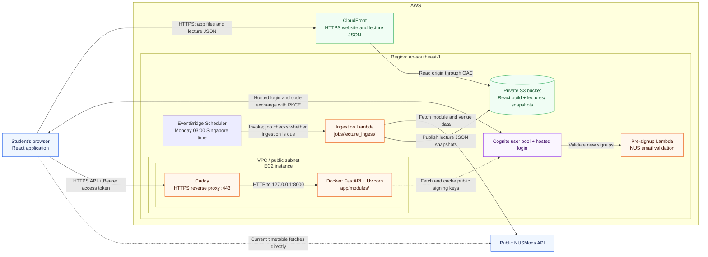

# Architecture

LectureKaki groups code by where it runs. React runs in the browser (served by
Nginx locally). FastAPI is a modular monolith released as one backend image.
Scheduled jobs and Cognito triggers are packaged separately as Lambdas.

## Target AWS deployment

S3 and CloudFront serve the React build and lecture JSON; an EC2 instance runs
the FastAPI container behind Caddy. There is no API Gateway.



### Infrastructure stacks

Each `infra/` template is its own stack, named `lecture-kaki-<part>-<env>`.
Deploy hosting before ingestion; delete ingestion first. The user pool and web
bucket are retained on stack deletion. Lambda packages go to a separate private
artifact bucket.

| Stack | Template | Owns | Status |
| --- | --- | --- | --- |
| `auth` | `infra/auth.yaml` | Cognito user pool, hosted login, pre-signup Lambda | Template ready |
| `hosting` | `infra/hosting.yaml` | Web bucket (exports name and ARN); CloudFront to be added | Bucket only |
| `ingest` | `infra/ingest.yaml` | Ingestion Lambda, schedule, logs, failure alarm | Template ready |
| `api` | — | EC2, Caddy, FastAPI container | Not started |

### Login and API access

1. React redirects to Cognito hosted login (authorization code + S256 PKCE).
2. Cognito redirects to `/auth/callback`; React exchanges the code for tokens.
3. React calls the API with `Authorization: Bearer <access_token>`.
4. `get_current_user` validates the token and returns the Cognito `sub` as the
   user ID.

The backend needs only `AWS_REGION`, `COGNITO_USER_POOL_ID`, `COGNITO_CLIENT_ID`
and `COGNITO_DOMAIN`; no AWS keys or client secret.

### Still to build

- **EC2 API:** stable DNS name, Caddy for HTTPS, backend bound to
  `127.0.0.1:8000`, auto-restart, CloudWatch logs and health monitoring.
- **CORS:** allow the CloudFront and local frontend origins with the
  `Authorization` and `Content-Type` headers.
- **Frontend login:** callback, refresh and logout; register the exact callback
  and logout URLs in Cognito.
- **CloudFront:** OAC to the bucket; serve `index.html` for app routes only, so
  missing `/lectures/*` files stay errors; follow the
  [lecture-data](lecture-data.md) cache headers.
- **Frontend upload:** keep lecture data when syncing:
  `aws s3 sync frontend/dist/ s3://<WebBucketName> --delete --exclude "lectures/*"`.

Timetable selections stay in browser storage; account-based persistence would
need a separate API and database.

References: [authentication](authentication.md), [lecture data](lecture-data.md),
[personal AWS setup](aws-dev-setup.md),
[CloudFront OAC](https://docs.aws.amazon.com/AmazonCloudFront/latest/DeveloperGuide/private-content-restricting-access-to-s3.html),
[Cognito JWT verification](https://docs.aws.amazon.com/cognito/latest/developerguide/amazon-cognito-user-pools-using-tokens-verifying-a-jwt.html).

## Repository structure

```text
frontend/src/features/
  timetable/              Timetable UI, NUSMods import, clash detection, storage
backend/
  app/                    FastAPI application and API modules
  jobs/lecture_ingest/    Scheduled ingestion job (own Lambda; handler.py entry)
  lambdas/pre_signup/     Cognito signup trigger (own Lambda)
  scripts/                Local ingestion and Lambda packaging
  tests/                  API, trigger and job tests
infra/                    CloudFormation templates
```

```text
backend/app/
  main.py                 App composition; registers module routers
  health.py               Health endpoint
  modules/auth/
    __init__.py           Public interface: router, CurrentUser, get_current_user
    api.py                Routes
    dependencies.py       Token validation and signing-key cache
    schemas.py            Data contracts
```

Add features under `app/modules/<feature>/` and register their routers in
`main.py`. Each module owns its schemas, rules and data access; other modules use
its public interface. Protect routes with the auth dependency:

```python
from app.modules.auth import CurrentUser, get_current_user

def protected_operation(user: Annotated[CurrentUser, Depends(get_current_user)]):
    return {"user_id": user.user_id}
```

Lambdas and jobs are in the backend test image but excluded from the API runtime
image. `scripts/package_ingest.py` builds the ingestion ZIP;
`scripts/ingest_local.py` runs the same handler against in-memory S3.
